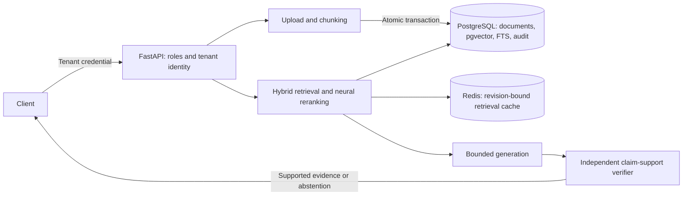

# Architecture

## Retrieval

The production adapter uses pgvector cosine search and indexed PostgreSQL English
full-text search. Normalized lexical terms are combined with OR for recall.
Reciprocal rank fusion combines independent rankings; a TinyBERT cross-encoder
reranks the bounded candidate set. Chunk and character budgets limit prompt
size, and a per-document cap reduces duplicate evidence. Fixed character windows
and recursive paragraph/sentence chunking are both available for comparison.
The local adapter retains deterministic lexical BM25 and Chroma for fast tests.
The database full-text rank is **not** described as BM25.

Model revisions are pinned in `app/rag/models.py`. The embedding model identity
is part of each index and cache namespace. Changing models requires reingestion;
no incompatible vectors are silently mixed.

## Persistence and concurrency

PostgreSQL stores originals, extracted text, metadata, chunks, embeddings,
full-text indexes, usage counters, revision counters, and audit events. Index
replacement and deletion commit atomically. A failed embedding call leaves the
old index intact; a failed insertion rolls back its replacement. Tenant usage
rows serialize quota mutations across processes. Shared storage permits API
replicas without local document files or process-local cache invalidation.

Redis retrieval-cache keys bind tenant, corpus revision, question, model/version,
retrieval/reranking options, and context budgets. Every corpus mutation updates
its revision inside the storage transaction. Cache entries expire; old revisions
cannot be reused after deletion or reingestion. Generation output is not cached.
Redis failure falls back to uncached retrieval; distributed rate limiting fails
closed. The Compose Redis configuration uses `noeviction` so memory pressure
cannot silently discard rate-limit counters. Cache writes tolerate a full cache.

## Security

A server-owned credential map binds each secret to a tenant and a reader,
writer, or admin role. Client-supplied tenant headers never select a namespace.
Reader credentials can retrieve, writers can manage documents, and admins can
read their tenant's audit log. Global operational metrics require a separate operator credential. Shared query limits are keyed by
hashed tenant identity. Rotation can map multiple credentials to one tenant.

Every pooled database transaction sets a **transaction-local** tenant identity.
Tables force row-level security, with both read and write policies. The API
login cannot own tables, bypass RLS, create roles, or truncate audit history.
Parameterized queries and composite tenant/document foreign keys provide
additional isolation. Readiness rejects privileged database logins. The trusted
application/database connection is a security boundary: RLS protects omitted
filters and tenant-context mistakes; it does not make arbitrary SQL execution
with application credentials safe.

Capacity controls bound uploads, extracted content, chunk counts, total tenant
storage, query length, candidates, context, and generated tokens. The SQL schema
uses native half-vector HNSW indexes for the bundled 384-dimensional model and
1536-dimensional embeddings. Other dimensions use exact vector search until an
operator provisions a matching index.

## Generation and hallucination control

Production generation supports OpenAI or a private compatible inference endpoint.
Provider timeouts, retries, and output limits are bounded. Rules live in a system
message; retrieved passages are untrusted data with server-issued citation labels.
Provider-reported generation token usage and optionally configured cost estimates
are exposed in diagnostics. Embedding/hardware costs are not included in that
estimate.

The verification gate (`verify_answer` in `app/rag/answering.py`) is shared by
the API and the evaluation runner, so measured coverage is what users receive:

1. **Abstention.** Refusals ("the sources do not specify ...") are recognized as
   abstentions, returned as the standard no-answer response, and counted
   separately rather than as hallucinated claims.
2. **Citations.** The model cites short server-issued labels (`[S1]`, `[S1, S3]`)
   instead of copying 64-character chunk ids. Small models corrupted long hashes
   in 20% of answers; labels cost about 30 fewer tokens each. Any label that does
   not map to a retrieved passage rejects the answer.
3. **Claim support.** A DeBERTa NLI cross-encoder scores each answer sentence
   against windows of 1-3 evidence sentences plus the full passage, using the
   8 most lexically overlapping windows per claim to bound CPU cost. The model is
   trained on sentence-length premises; scoring whole 650-character chunks
   diluted entailment so much that stated facts scored ~0.02 instead of ~0.99.
   Every claim must reach entailment >= 0.5 or the API abstains.

Streaming with this gate buffers the answer; it does not release unverified
tokens. NLI remains an imperfect automated check, particularly for numbers and
paraphrase; it measures support by retrieved context, not external truth, and
does not replace human review.

## Compatibility

The development-only `/ask` engine and existing local/Supabase metadata adapters
remain for compatibility; the public demo endpoint is disabled in production.
Production storage uses the shared `DATABASE_URL` adapter, including when the
PostgreSQL server is hosted by Supabase. Old REST metadata migrations are retained
under `supabase/migrations` for existing installations, not used by the new shared
storage path.
